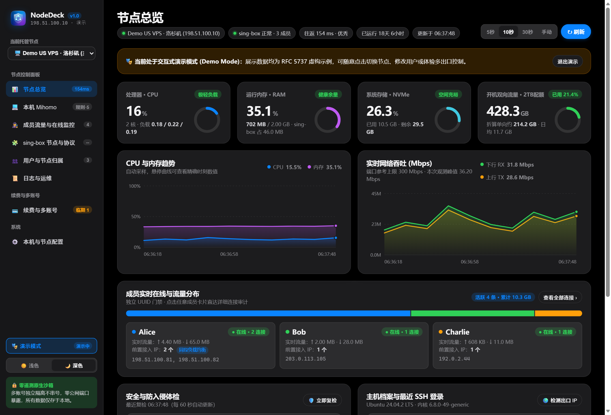
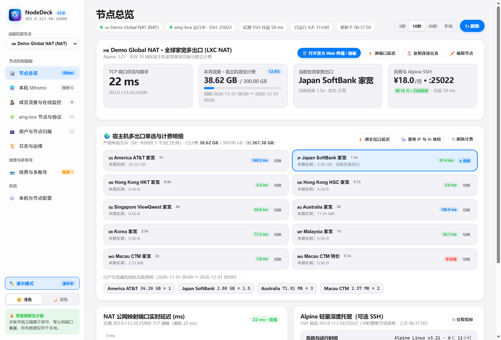
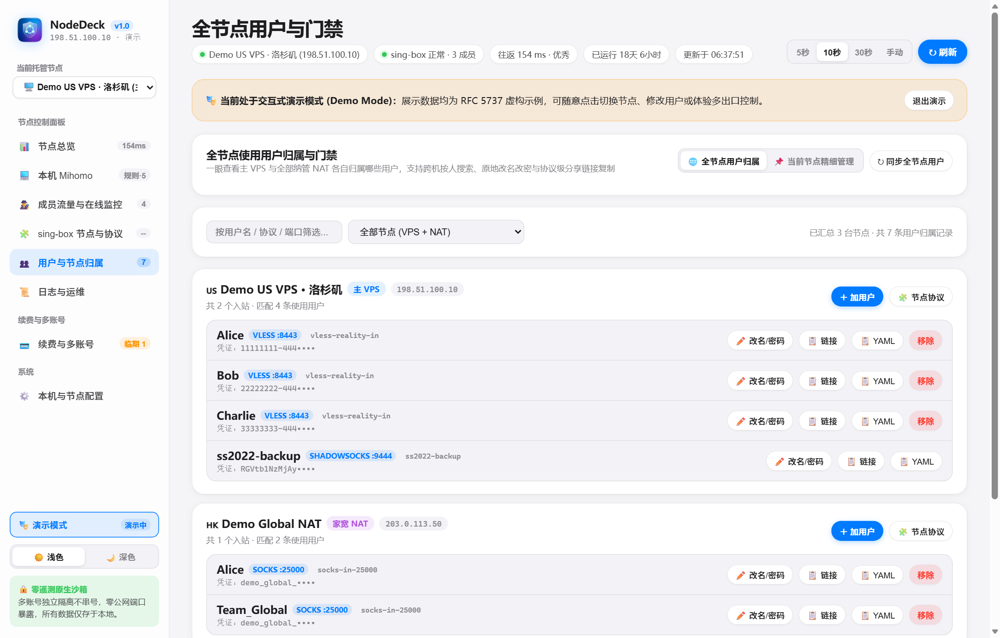
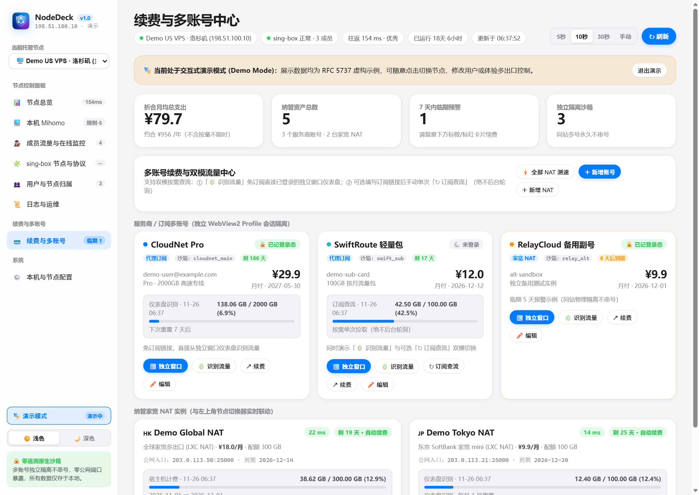
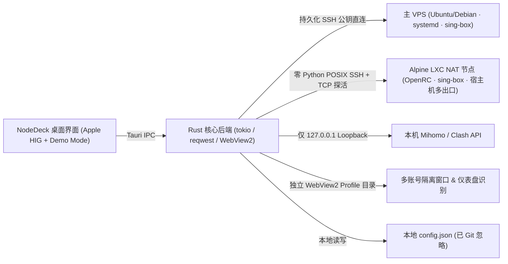

<div align="center">


# NodeDeck

**轻量原生、零遥测的跨节点桌面控制面板**  
一站式托管 Linux VPS、Alpine 家宽 NAT、`sing-box` 多协议用户、本机 Mihomo / Clash 内核与多账号续费沙箱

[简体中文](./README.md) · [English](./README_EN.md)


</div>

---

## ✨ 简介

**NodeDeck** 是一款基于 **Rust + Tauri v2 + 原生 WebView2** 构建的开源轻量桌面面板（单文件绿色版仅约 **6 MB**，无 Node.js/Electron 运行时负担）。  
它面向自建网络节点与多台 VPS / 家宽 NAT 运维者，强调 **“零隐私预设、全手动引入、本地零暴露”**：

- 🚫 **零硬编码、零后台遥测**：不包含任何预设服务器、商家网址或订阅链接，所有节点与账号均由你在本地界面手动添加，配置仅保存在你电脑的 `config.json`。
- 🔒 **原生免密直连与零公网暴露**：通过 Windows 原生 `ssh.exe` 公钥免密连接服务器；流量统计接口强制仅监听 `127.0.0.1` 回环地址并配随机 32 位密钥，公网零端口暴露。
- 🎭 **内置零隐私交互式演示模式（Demo Mode）**：无需准备真实服务器，打开应用点左侧 **「🎭 演示模式」**（或本地预览 `src/index.html?demo=1`），即可完整体验所有页面与交互（全部使用 RFC 5737 虚构示例数据）。

---

## 🖼️ 演示界面（Demo Mode 实机截图）

> 以下截图均直接采集自内置 **演示模式（RFC 5737 虚构示例数据）**，展示浅色 / 深色双外观与核心页面。

### 1. 主 VPS 节点总览（浅色 / 深色自适应）
| ☀️ 浅色模式 (Light) | 🌙 深色模式 (Dark) |
| :---: | :---: |
|  |  |

### 2. 家宽 NAT 托管与多出口单选切换


### 3. 全节点用户归属矩阵与跨协议分享


### 4. 多账号独立隔离沙箱与双模流量中心


---

## 🚀 核心特性

### 1. 混合架构全纳管：主 VPS + 任意台 Alpine / LXC NAT
- **主 VPS（Ubuntu / Debian `systemd`）**：长连接持久化 SSH 通道，低开销采集 CPU / 内存 / NVMe 磁盘 / 实时吞吐曲线、UFW 防火墙标注、fail2ban 爆破拦截统计与出口 IP 体检。
- **家宽 / LXC NAT（Alpine OpenRC）**：**零 Python 依赖**（纯 POSIX `sh` + 原生异步 TCP 握手探活 + 30 秒 SWR 无闪烁缓存），适配 128 MB 超小内存容器；支持免 SSH 纯面板模式，也支持映射 SSH 端口解锁深度托管。
- **宿主机多出口单选控制**：兼容支持宿主机出口切换 API（`http://10.10.0.1:19090/v1`）的家宽 NAT，提供互斥单选网格、全出口延迟实测、分地区计费明细与落地 IP / AI 网站体检。

### 2. `sing-box` 四大主力协议统一增删改 + 自动回滚
- 跨主 VPS 与全部 Alpine NAT 统一支持 **VLESS + Reality**、**SOCKS5**、**Shadowsocks-2022**、**HTTP**、**Mixed** 入站节点的增、删、改（协议、端口、名称、SNI、密码 / UUID / SS-2022 密钥）。
- **原子安全护栏**：每次变更自动滚动备份（保留最近 10 份）→ 执行 `sing-box check` 语法校验 → 自动重载/重启 → 校验失败自动秒级回滚，绝不把线上节点改挂。

### 3. 全节点用户归属矩阵 & 协议级精准分享链接
- 一眼查看所有 VPS 与 NAT 各自归属哪些使用用户，支持跨机按人/协议/端口检索、原地改名改密与暂停/恢复。
- **严格对齐客户端规范的分享导出**：
  - 自动按协议生成标准链接：`vless://...`、`socks://<RawBase64(UTF8(u:p))>@host:port#remark`、`http://...`、`ss://<RawURLBase64(m:p)>@host:port#remark`（完美兼容中文备注与密码，避免 `=` 填充转义污染）。
  - 一键生成带 `dialer-proxy` 的 **Mihomo / Clash 链式落地 YAML** 片段。

### 4. `127.0.0.1` 零暴露成员流量与防外泄审计
- 一键为主 VPS 或任意 Alpine NAT 开启本地 Clash API 统计口（仅监听 `127.0.0.1` + 随机 32 位 Bearer Secret），按用户实时追踪活跃连接、上传/下载流量与来源前置 IP。
- 同一用户并发出现 `≥ 3` 个不同 `/24` 网段自动标红预警，智能识别同网段双 IP 负载均衡，支持单条或一键掐断连接。

### 5. 多账号物理沙箱隔离 + 双模按需流量查流
- **WebView2 Profile 级物理隔离**：为每个 `profileId` 分配独立 Cookie / LocalStorage 目录，同一服务商网站同时登录主号/副号永不串号。
- **双模按需查流（绝不后台静默轮询）**：
  1. **🪞 仪表盘页面识别（免订阅链接）**：直接从你已登录的独立窗口仪表盘中通过 WebView2 `eval_with_callback` 读取已用/总流量与到期日，彻底告别泄露订阅链接风险。
  2. **↻ 订阅查流（可选手动单次）**：若希望通过订阅头查流，可在编辑卡片中选填订阅链接，仅在你手动点击按钮时单次拉取 `subscription-userinfo`（直连失败自动回退本机 Mihomo 代理端口）。

### 6. 本机 Mihomo / Clash API 联动
- 兼容 **Clash Verge Rev / FlClash / Mihomo Meta** 等全部支持 Clash External Controller API（仅限 `127.0.0.1` / `localhost`）的本机客户端。
- 支持规则/全局/直连切换、策略组选节点与测速、实时连接分流排查、AI 平台并发连通性测速及可选内嵌原版 Web UI。

---

## 🏗️ 系统架构



---

## 📦 快速上手

### 方式一：下载预编译绿色版（推荐）
前往本仓库 [Releases](../../releases) 下载最新 `NodeDeck-windows-x64.zip`，解压后直接双击 `NodeDeck.exe` 即可运行（无需安装，配置文件自动生成在同目录 `config.json`）。

### 方式二：从源码编译（Windows 10 / 11）

**前置要求：**
- [Rust Stable 工具链](https://rustup.rs/)（含 MSVC 构建工具）
- Windows 10 / 11 内置 WebView2 Runtime 与 OpenSSH 客户端 (`ssh.exe`)

```powershell
# 1. 克隆仓库
git clone https://github.com/waterplasticstudy-bot/NodeDeck.git
cd NodeDeck

# 2. 运行开源隐私防泄漏自检（可选）
node scripts/privacy-check.mjs

# 3. 执行严格代码检查与 Release 编译（输出单文件绿色版 NodeDeck.exe）
cargo clippy --manifest-path src-tauri/Cargo.toml --all-targets -- -D warnings
cargo build --manifest-path src-tauri/Cargo.toml --release
```

编译产物位于：`src-tauri/target/release/NodeDeck.exe`（约 6 MB）。

### 首次运行配置指引
1. 启动 `NodeDeck.exe` 后，首次运行为空白引导态（也可点左侧 **「🎭 演示模式」** 先体验完整功能）。
2. **引入主 VPS**：进入 **「⚙️ 本机与节点配置」**，填入你的主 VPS IP、SSH 端口、用户名与私钥路径（可点「🔑 一键配置 SSH 免密向导」自动生成并上传 Ed25519 公钥），点击保存即可连接。
3. **引入 NAT 与多账号**：进入 **「💳 续费与多账号」**，点「＋ 新增 NAT」引入你的 Alpine/LXC NAT 实例（填写公网 IP、服务端口与可选 SSH 映射端口），点「＋ 新增账号」添加任意服务商续费与独立沙箱卡片。
4. 完整配置结构参考仓库根目录的 [`config.example.json`](./config.example.json)。

---

## 🛡️ 隐私与安全设计

- **数据纯本地化**：`config.json` 与 WebView2 沙箱目录默认存放在本地程序数据路径，已在 `.gitignore` 严格忽略，绝不上传任何云端服务器。
- **绝不保存明文密码**：SSH 仅使用本地公钥免密认证；服务商多账号仅通过原生 WebView2 独立 Profile 维持官方登录 Cookie，面板本身不读取也不存储你的任何登录密码。
- **自动化防泄漏门禁**：内置 [`scripts/privacy-check.mjs`](./scripts/privacy-check.mjs)，已在 GitHub Actions CI 中强制拦截个人配置与私钥特征。

---

## 🤝 参与贡献与免责声明

欢迎提交 Issue 与 Pull Request，贡献规范请参阅 [CONTRIBUTING.md](./CONTRIBUTING.md)。

> **免责声明**：本项目仅用于个人合法合规的 Linux 服务器运维、网络连通性诊断、多节点资产台账管理与技术学习研究，请严格遵守所在国家与地区的法律法规。

## 📄 开源协议

本项目基于 [MIT License](./LICENSE) 开源。
