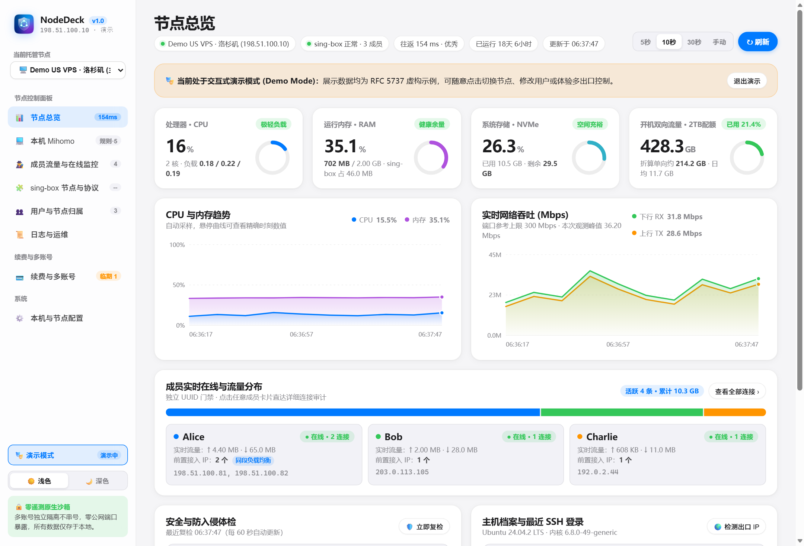
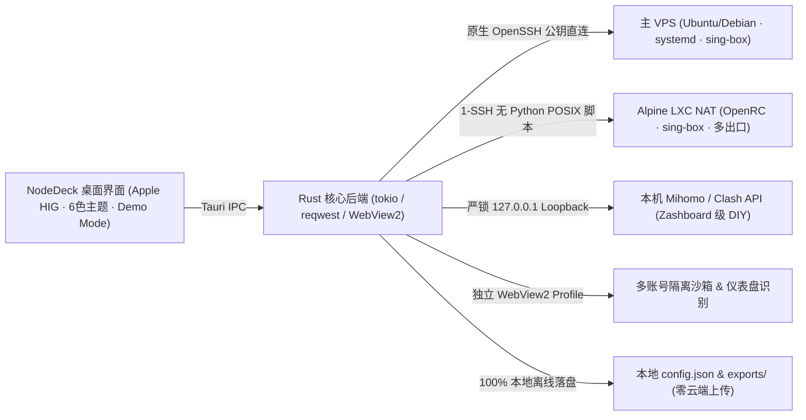

<div align="center">


# NodeDeck

**100% 纯本地 · 零遥测 · 无服务端的轻量桌面节点工作台**  
一站式管好你的 **本机 Mihomo / Clash（Zashboard 级 DIY）**、**Linux VPS / Alpine 家宽 NAT**、**`sing-box` 多协议用户**、**纯离线全平台配置与二维码导出** 与 **多账号防串号续费沙箱**

[简体中文](./README.md) · [English](./README_EN.md) · [🔐 源码 SHA-256 校验清单](./SHA256SUMS-source.txt)


</div>

---

## ✨ 这是什么？适合谁？

**NodeDeck** 是一款基于 **Rust + Tauri v2 + 系统原生 WebView（Windows WebView2 / macOS WKWebView）** 打造的开源轻量桌面软件（Windows 单文件约 **6 MB**，同步提供 **macOS Apple Silicon & Intel `.dmg`**，零 Electron 臃肿、零 Node.js 运行时、零外部 CDN 依赖）。

无论你是刚入门的新手，还是同时维护多台机器的老玩家，**都不需要配齐“全家桶”才能用**：

- 🎭 **零基础先体验**：打开即点左下角 **「🎭 演示模式」**，不用任何服务器就能试用全部界面与 DIY 能力（内置全虚构 RFC 5737 示例数据）。
- 💻 **只有本机 Clash / Mihomo**：直接连接本机 `127.0.0.1:9090`，当作原生 **Zashboard 级桌面控制台**（节点排序、隐藏超时、自定义测速 URL、右键测速、实时规则搜索、连接表列自定义与右键复制）。
- 🖥️ **只有 1 台 VPS 或 NAT**：用内置 **「🔑 一键配置 SSH 免密向导」** 30 秒接管，图形化增删改 `sing-box` 协议与用户，一键离线导出全平台配置（`.yaml` / `.js`）与纯离线二维码。
- 💳 **多台节点 + 多商家账号**：多账号 WebView2 物理隔离永不串号、统一续费日历与折合月均支出统计。

---

## 🔒 零遥测 · 纯本地 · 不走任何服务端（透明声明）

> [!IMPORTANT]
> **NodeDeck 没有任何作者后端服务器、云端中转、订阅托管或数据收集接口。**  
> 你在软件中录入的 IP、密钥、订阅链接、导出的配置与登录态 **100% 仅保存在你自己的电脑本地**，全程完全开源可审计。

### 1. 本机数据落盘清单（Windows 位于程序同目录；macOS `.app` 位于 `~/Library/Application Support/com.nodedeck.desktop/`）
| 本地路径 | 存了什么 | 隐私保护机制 |
| :--- | :--- | :--- |
| `config.json` | 你的节点连接档案、NAT 清单、账号卡片与常用导出方案预设 | 仅存你本机；已在 `.gitignore` 严格忽略；**绝不保存 SSH 密码或网站登录密码** |
| `exports/` | 你手动点击生成的离线 `.yaml` / `.js` 客户端配置与导出日志 | 纯本机离线拼装并落盘，**零云端 Gist / 零在线托管链接** |
| `profiles/` / WKDataStore | 多账号独立浏览器沙箱（Windows WebView2 目录 / macOS 14+ 独立 `WKWebsiteDataStore`） | 每个 `profileId` 物理隔离，支持一键彻底清除登录态 |

### 2. 完整网络流向公开审计表（随时可抓包核验）
NodeDeck **不会**在后台向任何第三方发送遥测、崩溃报告或统计数据；程序发出的全部网络请求严格限定为以下几类：

| 功能模块 | 目标地址 | 触发时机 | 说明 |
| :--- | :--- | :--- | :--- |
| 主 VPS / NAT 运维 | **你自己的服务器 IP** | 打开节点面板 / 手动点击操作 | 调用系统原生 OpenSSH 公钥直连，无任何中间服务器 |
| 本机 Mihomo 控制 | **仅限 `127.0.0.1` / `localhost`** | 停留在 Mihomo 页或手动切换/测速 | 代码级硬限制禁止连接非本机回环地址 |
| 离线配置导出 / 二维码 / 演示模式 | **无（0 网络请求）** | 随时 | 100% 纯本地离线计算（内置 ISO/IEC 18004 二维码编码器） |
| 账号独立窗口 / 仪表盘识别 | **你自己填写的官网 URL** | 仅在你主动点击打开/识别时 | 无后台静默轮询；可选「订阅查流」也仅在手动点击时单次拉取 |
| 出口 IP 体检 / AI 连通性测速 | `ipinfo.io` / `ip-api.com` / AI 探测点 | 仅在你主动点击体检/测速按钮时 | 用于诊断节点连通性与出口归属 |

---

## 🖼️ 演示界面（采集自零隐私 Demo Mode）

### 1. 主 VPS 节点总览（浅色 / 深色 + 6 套强调色 DIY）
| ☀️ 浅色模式 (Light) | 🌙 深色模式 (Dark) |
| :---: | :---: |
|  |  |

### 2. 家宽 NAT 托管与多出口单选切换


### 3. 全节点用户归属矩阵与跨协议分享


### 4. 多账号独立隔离沙箱与双模流量中心


---

## 🚀 核心功能一览（v1.2.1）

### 1. 本机 Mihomo / Clash 联动（参考 Zashboard DIY 体验）
- 兼容 **Bettbox / Clash Verge Rev / FlClash / Mihomo Meta** 等全部本地 Clash API 内核，支持原版 Web UI 随时切换。
- **策略组 DIY 工具条**：节点按延迟/名称/默认排序、一键 **隐藏不可用/超时节点**、卡片密度切换（标准双列 / 紧凑多列 / 宽松卡片）、自定义测速 URL 与超时、**右键任意节点快捷测速**、单组并发 `⚡ 测整组`（完整支持含空格与 Emoji 策略组）。
- **📜 实时分流规则检视器（只读）**：直查当前内核生效的全部规则与 `.mrs` 规则集加载条数，按域名/类型/策略组秒级检索。
- **实时连接表 Zashboard 交互**：列显隐自定义、`⏸️ 暂停刷新`、按流量/域名/进程排序、**右键单元格一键复制域名或规则**。

### 2. 离线客户端配置生成器（自由 DIY + 4 重防出错护栏）
- 支持自由勾选单台或多台落地节点（VPS + 任意台 NAT 组合），纯本机离线生成：
  - **全平台单文件 `.yaml`**（Win10/11 · iOS 蓝猫 Clash Mi / Stash · 鸿蒙 4/7 通用，内置 50 MB iOS 防崩护栏与自包含防回环规则）；
  - **Bettbox / Clash Verge 万能覆写 `.js` v4.4**。
- **高度自由 DIY**：
  - 「落地出口」备选国家 3 模式（🤖 自动跟随所选落地地区 / 🎯 10 国多选胶囊 / 🔒 仅自建落地）；
  - 前置地区 3 模式（亚太低延迟 / 全部 / 自定义）、精准 `>1x` 倍率过滤（放行 `0.1x / 0.5x / 0.9x / 1x`）、自定义测速 URL；
  - 普通流量默认去向（`🛡️ 落地出口优先` vs `⚡ 机场直出优先省流量`）、运维防回环 IP 隔离、**可视化自定义规则箱**（免写 YAML 自动校验去重）；
  - 常用配方可存为本机预设方案，后续换订阅/换密钥 **2 秒一键重出**。
- **4 重防出错护栏**：Go RE2 禁前瞻强校验、空池多层保底、发他人前隐私防误发预警、全套防定位泄露与防国内 STUN 反射规则。

### 3. 混合架构全纳管 + `sing-box` 多协议 CRUD + 离线二维码
- **主 VPS (`systemd`) + Alpine LXC NAT (`OpenRC`)**：NAT 端零 Python 依赖、128 MB 小内存友好、单次 SSH 合并查询提速 50%。
- **4 协议统一管理**：VLESS + Reality、Shadowsocks-2022、SOCKS5、HTTP、Mixed 一键增删改，每次修改自动滚动备份 + `sing-box check` 校验失败秒级回滚。
- **纯离线二维码**：内置零依赖 ISO/IEC 18004 QR 编码器（支持 V1–V16 / 中文 UTF-8 / 长 VLESS+Reality 链接），不请求任何外部二维码接口。

### 4. `127.0.0.1` 零暴露成员审计、多账号隔离沙箱与外观 DIY
- 成员实时流量与多 `/24` 网段异常共享标红预警，统计接口严锁 `127.0.0.1` + 32 位随机密钥。
- 多账号 WebView2 Profile 级物理隔离不串号，支持免订阅仪表盘识别流量 + 可选手动单次订阅查流。
- **全局外观 DIY & 效率快捷键**：6 套精选强调色（浅/深双主题自适应）、舒适/紧凑全局密度、Mihomo 辅助卡片显隐开关、`Ctrl+K` 全局命令面板、`Ctrl+R` 刷新、日志语义高亮与导出。

---

## 📦 新人 3 分钟上手

### 方式一：下载 GitHub Actions 官方公开构建版（推荐）
1. 前往本仓库 [Releases](../../releases) 下载对应系统安装包与同版本 `SHA256SUMS.txt`：
   - **Windows 10/11 (x64)**：`NodeDeck-windows-x64.exe`（或 `NodeDeck-windows-x64-portable.zip`），绿色免安装；
   - **macOS Apple Silicon (M1–M4)**：`NodeDeck-macos-arm64.dmg`；
   - **macOS Intel**：`NodeDeck-macos-x64.dmg`。
2. 核对 SHA-256 哈希值（见下方校验步骤）。**macOS 首次打开提示**：因本项目为个人免费开源软件未购买 Apple 开发者公证，拖入「应用程序」后若提示无法验证，请在终端执行一次：
   ```bash
   xattr -cr /Applications/NodeDeck.app
   ```
3. 首次打开推荐操作路径：
   - **想先逛逛**：点左下角 **「🎭 演示模式」**，零配置完整体验；
   - **想管本机代理**：点左侧 **「💻 本机 Mihomo」**，填入本机控制地址（默认 `http://127.0.0.1:9090`）和密钥即可；
   - **想管 VPS / NAT**：点 **「⚙️ 本机与节点配置」** 填 IP 后点 **「🔑 一键配置 SSH 免密向导」**，或在 **「💳 续费与多账号」** 中新增 NAT 与服务商卡片（配置结构可参考 [`config.example.json`](./config.example.json)）。

### 方式二：自己从源码编译（Windows & macOS，100% 自主掌控）
前置要求：[Rust Stable](https://rustup.rs/)、Node.js 22+（校验脚本与 macOS 打包）；Windows 需内置 WebView2/OpenSSH，macOS 需 Xcode Command Line Tools。

```bash
# 1. 克隆仓库
git clone https://github.com/waterplasticstudy-bot/NodeDeck.git
cd NodeDeck

# 2. 运行全链路自动化质量与隐私门禁（19 项检测）
node scripts/verify-all.mjs

# 3. 执行 Rust 单元测试、严格 Clippy 检查与 Release 编译
cargo test --manifest-path src-tauri/Cargo.toml
cargo clippy --manifest-path src-tauri/Cargo.toml --all-targets -- -D warnings
# Windows 生成单文件 .exe：
cargo build --manifest-path src-tauri/Cargo.toml --release
# macOS 生成 .app：
npx --yes @tauri-apps/cli@2 build --bundles app
```

Windows 产物位于 `src-tauri/target/release/NodeDeck.exe`（约 6 MB），macOS 产物位于 `src-tauri/target/release/bundle/macos/NodeDeck.app`。

---

## 🔐 公开 SHA-256 哈希校验（可复现可验证）

为保证你拿到的程序与仓库公开源码 100% 一致、未被任何中间环节篡改：

1. **二进制安装包校验（以 GitHub Actions 自动产出为准）**：  
   每次发布 tag 时，GitHub Actions 会在纯净的公开 `windows-latest` 与 `macos-latest` 环境中从零编译，并自动在 [Releases](../../releases) 正文与附件 **`SHA256SUMS.txt`** 中公布全部 Windows 与 macOS 安装包的真实 SHA-256 哈希：
   ```powershell
   # Windows PowerShell
   Get-FileHash .\NodeDeck-windows-x64.exe -Algorithm SHA256
   ```
   ```bash
   # macOS Terminal
   shasum -a 256 NodeDeck-macos-arm64.dmg
   ```
   将输出与对应 Release 页面的 `SHA256SUMS.txt` 逐位比对即可。

2. **关键安全模块与核心脚本源码哈希（已公开在仓库根目录）**：  
   见 **[`SHA256SUMS-source.txt`](./SHA256SUMS-source.txt)**，覆盖远端采集脚本（`remote_agent.py` / `remote_agent_alpine.sh`）、Rust 核心通信模块（`ssh_client.rs` / `mihomo.rs` / `config.rs` / `accounts.rs`）、离线配置与二维码生成器（`client-export.js` / `qrcode.js`）以及自动化门禁脚本（`privacy-check.mjs` / `verify-all.mjs`）。本地克隆后可直接核验：
   ```powershell
   Get-Content .\SHA256SUMS-source.txt | Where-Object { $_ -and $_ -notlike '#*' } | ForEach-Object {
     $expected, $file = $_ -split '\s+', 2
     $actual = (Get-FileHash $file.Trim() -Algorithm SHA256).Hash.ToLower()
     "{0}  {1}" -f ($(if ($actual -eq $expected.ToLower()) { 'OK  ' } else { 'FAIL' }), $file.Trim())
   }
   ```

---

## 🏗️ 系统架构



---

## 🤝 参与贡献与免责声明

欢迎提交 Issue 与 Pull Request，贡献规范请参阅 [CONTRIBUTING.md](./CONTRIBUTING.md)。

> **免责声明**：本项目仅用于个人合法合规的 Linux 服务器运维、本机网络工具可视化管理、连通性诊断与多节点资产台账记录，请严格遵守所在国家与地区的法律法规。

## 📄 开源协议

本项目基于 [MIT License](./LICENSE) 开源。
