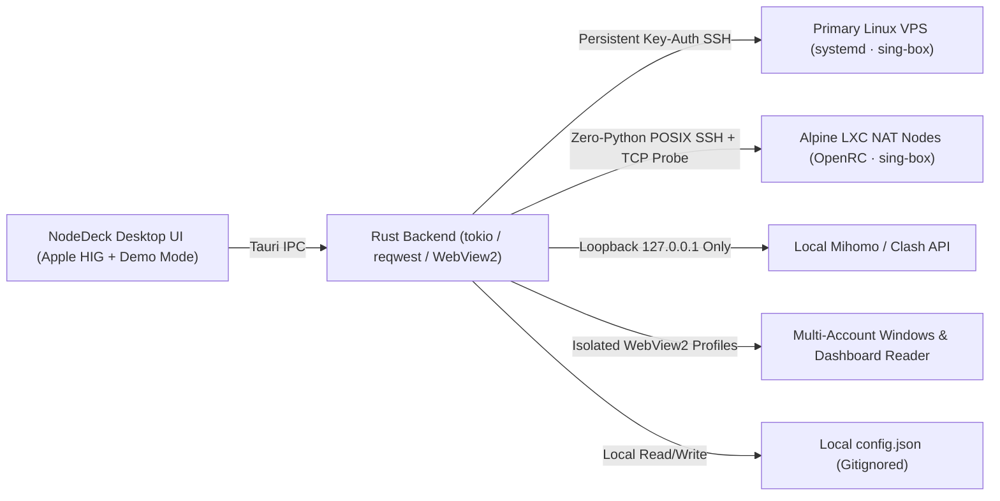

<div align="center">


# NodeDeck

**A lightweight, zero-telemetry native desktop control plane for multi-node VPS, Alpine NAT, `sing-box`, local Mihomo/Clash API, and isolated multi-account renewal management.**

[简体中文](./README.md) · [English](./README_EN.md)


</div>

---

## ✨ Overview

**NodeDeck** is an open-source Windows desktop control plane built with **Rust + Tauri v2 + native WebView2** (~6 MB portable executable, zero Electron bloat). Designed for self-hosted network operators managing a primary Linux VPS alongside multiple Alpine LXC NAT nodes, it follows a strict **Zero-Preset, Local-Only, Zero-Exposure** philosophy:

- 🚫 **Zero Presets & Zero Telemetry**: Ships completely blank with zero hardcoded servers, providers, or subscription URLs. All VPS, NAT, and provider cards are added manually and stored solely in your local `config.json`.
- 🔒 **Passwordless SSH & Loopback-Only Audit**: Connects directly via native Windows `ssh.exe` key auth. Live traffic/connection audit APIs bind exclusively to `127.0.0.1` with a random 32-char secret — zero public management ports exposed.
- 🎭 **Built-in Interactive Demo Mode**: Explore every tab, chart, multi-exit grid, user matrix, and renewal card without connecting any real server — just toggle **「🎭 演示模式」** in the sidebar (powered entirely by fictional RFC 5737 data).

---

## 🖼️ Screenshots (Captured from Zero-Privacy Demo Mode)

### 1. Primary VPS Overview (Light & Dark Themes)
| ☀️ Light Mode | 🌙 Dark Mode |
| :---: | :---: |
|  |  |

### 2. Alpine NAT Control & Single-Select Residential Exits


### 3. Cross-Node User Ownership Matrix & Protocol-Exact Sharing


### 4. Isolated Multi-Account Sandbox & Dual-Mode Traffic Sync


---

## 🚀 Key Features

1. **Hybrid Multi-Node Fleet Management**
   - **Primary Linux VPS (`systemd`)**: Persistent SSH channel with real-time CPU, RAM, NVMe, and RX/TX charts, UFW port annotations, fail2ban intrusion telemetry, and dual-source exit IP inspection.
   - **Alpine / LXC NAT Nodes (`OpenRC`)**: **Zero-Python** POSIX shell agent built for ultra-low-RAM containers (128 MB+), native async TCP latency probing, SWR flicker-free caching, and optional host multi-exit single-select switching (`10.10.0.1:19090/v1`).
2. **Unified 4-Protocol `sing-box` CRUD with Automatic Rollback**
   - Manage **VLESS + Reality**, **SOCKS5**, **Shadowsocks-2022**, **HTTP**, and **Mixed** inbounds across both VPS and NAT nodes.
   - Every edit creates a rolling backup (last 10 retained), runs `sing-box check`, and rolls back automatically on validation error.
3. **Cross-Node User Ownership Matrix & Standards-Compliant Share Links**
   - Inspect, search, rename, reset credentials, pause/resume, or remove users across all VPS and NAT nodes from one unified view.
   - Generates protocol-exact share links (`vless://`, unpadded UTF-8 Base64 `socks://` & `http://`, SIP002 RawURL Base64 `ss://`) and chained **Mihomo / Clash YAML** snippets (`dialer-proxy`).
4. **Loopback-Only Live Traffic & Anti-Sharing Audit**
   - Enable `127.0.0.1` Clash API monitoring per node to inspect live connections, per-user bandwidth, and multi-`/24` subnet concurrency alerts without exposing a single public port.
5. **Isolated Multi-Account WebView2 Sandboxes & Dual-Mode On-Demand Traffic Sync**
   - Dedicated `data_directory` per `profileId` keeps cookies and sessions physically separated even when signing into multiple accounts on the same provider portal.
   - **Mode A (Zero-Subscription Dashboard Scraping)**: Read used/total traffic directly from your signed-in dashboard window via native WebView2 `eval_with_callback`.
   - **Mode B (Optional One-Shot Subscription Check)**: Optionally attach a subscription URL for manual single-shot `subscription-userinfo` inspection (with local Mihomo proxy fallback — **never auto-polled**).
6. **Local Mihomo / Clash API Integration**
   - Works with **Clash Verge Rev**, **FlClash**, **Mihomo Meta**, and any local Clash External Controller (`127.0.0.1` / `localhost` only).
   - Features **zero-hardcoded `dialer-proxy` chain topology auto-discovery** with recursive leaf resolution, smart group prioritization, live connection filtering, AI connectivity probing, and a provider-agnostic universal override template ([mihomo-universal-override.example.js](./docs/mihomo-universal-override.example.js)).

---

## 🏗️ Architecture



---

## 📦 Getting Started

### Option 1: Portable Release Binary
Download the latest `NodeDeck-windows-x64.zip` from [Releases](../../releases), extract, and run `NodeDeck.exe`. Configuration is saved alongside the app in `config.json`.

### Option 2: Build from Source (Windows 10 / 11)
Prerequisites: [Rust Stable](https://rustup.rs/) with MSVC toolchain, plus Windows built-in WebView2 and OpenSSH (`ssh.exe`).

```powershell
git clone https://github.com/waterplasticstudy-bot/NodeDeck.git
cd NodeDeck

# Optional privacy guard check
node scripts/privacy-check.mjs

# Strict lint & portable release build
cargo clippy --manifest-path src-tauri/Cargo.toml --all-targets -- -D warnings
cargo build --manifest-path src-tauri/Cargo.toml --release
```

The portable executable will be generated at `src-tauri/target/release/NodeDeck.exe`. See [`config.example.json`](./config.example.json) for a clean RFC 5737 configuration schema reference.

---

## 🛡️ Privacy & Security Boundaries

- **Local-First Storage**: `config.json` and isolated WebView2 session profiles stay strictly on your machine and are excluded via `.gitignore`.
- **No Plaintext Passwords Stored**: SSH uses Ed25519 key auth; provider portals authenticate inside isolated WebView2 windows without NodeDeck ever reading or storing your passwords.
- **Automated Privacy Guard**: [`scripts/privacy-check.mjs`](./scripts/privacy-check.mjs) runs in CI to block accidental leaks of personal IPs, configs, or private keys.

---

## 📄 License & Disclaimer

Released under the [MIT License](./LICENSE). See [CONTRIBUTING.md](./CONTRIBUTING.md) for contribution guidelines.

> **Disclaimer**: NodeDeck is built for legitimate personal server administration, network diagnostics, and infrastructure tracking. Users are solely responsible for complying with applicable local laws and service provider terms.
