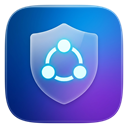
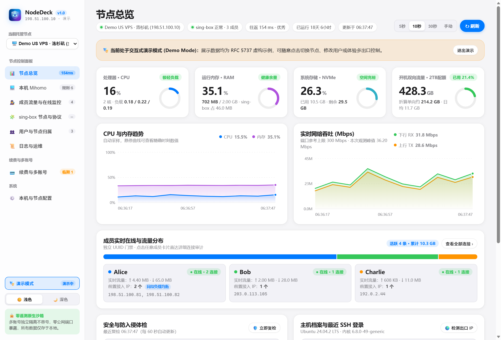
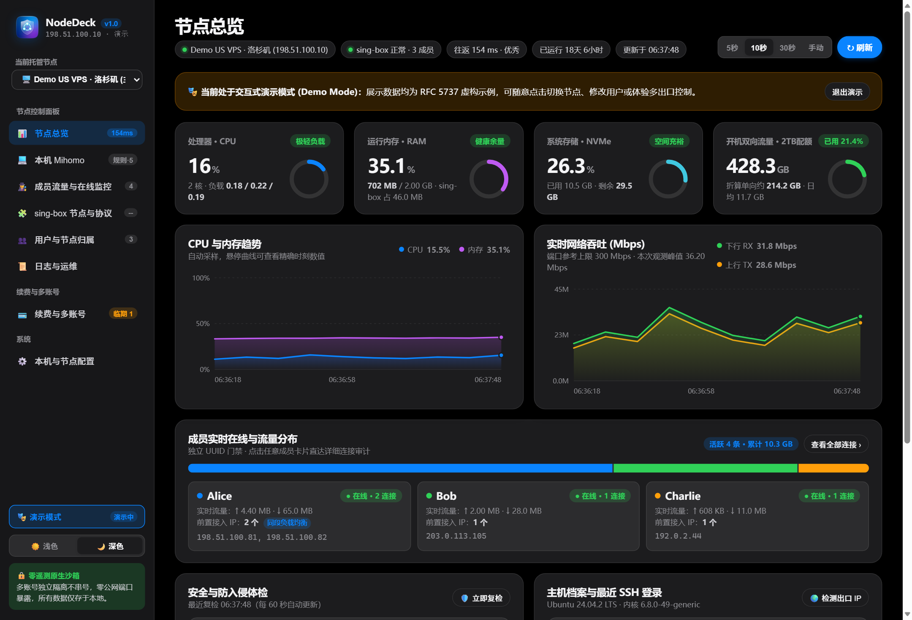
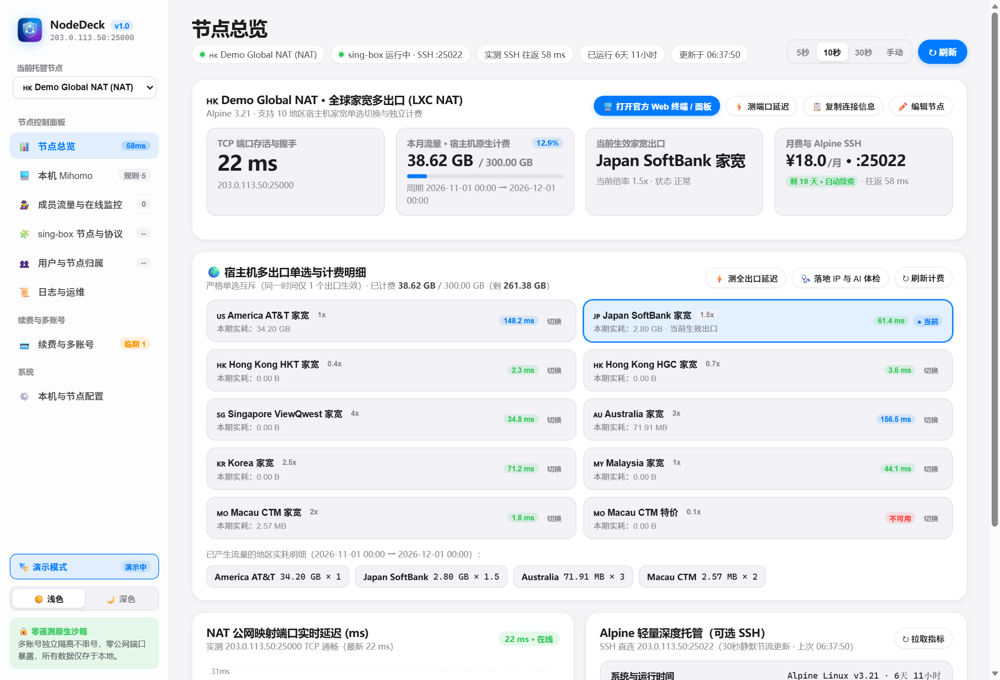
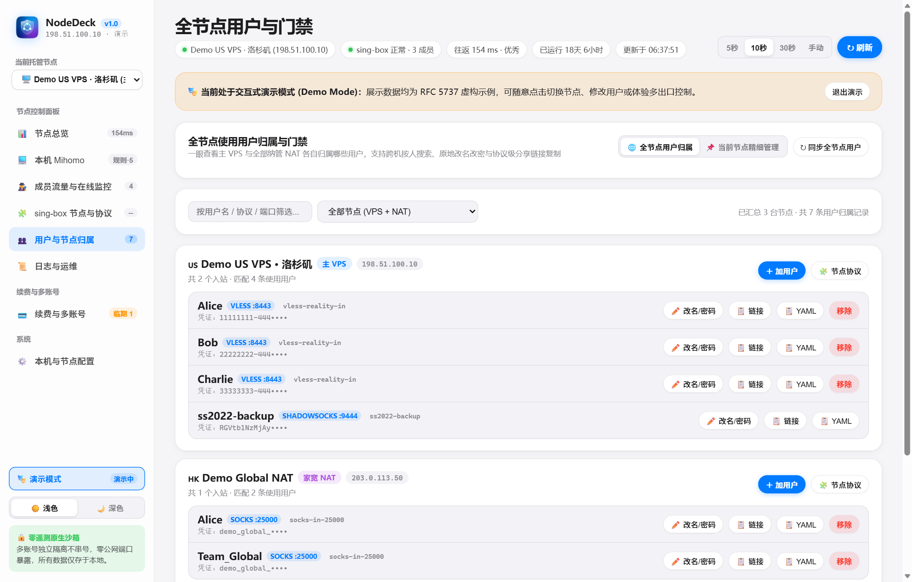
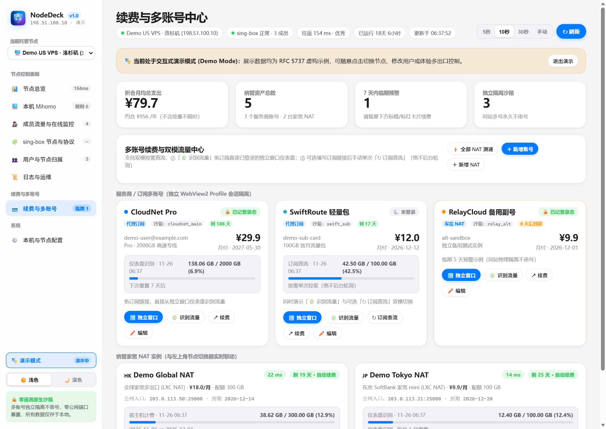

<div align="center">



# NodeDeck

**A 100% Local-Only, Zero-Telemetry, Serverless Portable Desktop Workbench**  
Manage your **local Mihomo / Clash API (Zashboard-style DIY)**, **Linux VPS & Alpine NAT fleet**, **`sing-box` multi-protocol users**, **pure-offline client configs & QR codes**, and **isolated multi-account sandboxes** in one ~6 MB Rust app.

[简体中文](./README.md) · [English](./README_EN.md) · [🔐 Source SHA-256 Checksums](./SHA256SUMS-source.txt)


</div>

---

## ✨ What Is NodeDeck? (Newcomer-Friendly)

**NodeDeck** is a lightweight open-source Windows desktop workbench built with **Rust + Tauri v2 + native WebView2** (~6 MB portable executable, zero Electron overhead, zero external CDN dependencies).

You do **not** need a complex multi-server setup to get started — use only the modules you need:

- 🎭 **Zero-Setup Preview**: Click **「🎭 演示模式」** (Demo Mode) in the sidebar to explore every page and DIY control instantly using fictional RFC 5737 data.
- 💻 **Local Mihomo / Clash Only**: Connect to `127.0.0.1:9090` for a native **Zashboard-style DIY controller** (node sorting, hide timed-out nodes, custom test URL, right-click quick latency test, live rule inspector, customizable connection columns & right-click copy).
- 🖥️ **Single VPS or NAT**: Built-in **SSH Key Wizard** sets up Ed25519 passwordless auth in seconds; manage `sing-box` protocols/users visually and export pure-offline `.yaml` / `.js` configs and offline QR codes.
- 💳 **Multi-Account & Renewal Tracking**: Physically isolated WebView2 cookie sandboxes prevent cross-account contamination even on the same provider portal.

---

## 🔒 Zero Telemetry · 100% Local-Only · No Backend Server

> [!IMPORTANT]
> **NodeDeck has NO author-operated server, NO cloud relay, NO analytics/telemetry, and NO online config hosting.**  
> Every IP, credential, preset, exported file, and browser session stays strictly on your own machine.

### Local Data Footprint (All Stored Next to the App)
- `config.json`: Your server endpoints, NAT list, renewal cards, and export presets (gitignored; **never stores SSH passwords or portal login passwords**).
- `exports/`: Offline-generated `.yaml` / `.js` client configs and exported logs (zero cloud Gist/hosting exposure).
- `profiles/`: Isolated WebView2 session directories per `profileId`, clearable in one click.

### Auditable Network Boundaries (Verify with Any Packet Sniffer)
1. **Your own VPS / NAT**: Direct key-auth connection via native Windows `ssh.exe` — zero intermediary relays.
2. **Local Mihomo / Clash API**: Hard-restricted in Rust to `127.0.0.1` / `localhost` loopback only.
3. **Offline Exporter, QR Generator & Demo Mode**: **0 network requests** (pure local ISO/IEC 18004 QR encoder & template engine).
4. **Provider Windows & On-Demand Probes**: Opened/fetched only on explicit user clicks — **never background-polled**.

---

## 🖼️ Screenshots (Captured from Zero-Privacy Demo Mode)

### 1. Primary VPS Overview (Light / Dark + 6 Accent Themes)
| ☀️ Light Mode | 🌙 Dark Mode |
| :---: | :---: |
|  |  |

### 2. Alpine NAT Control & Single-Select Residential Exits


### 3. Cross-Node User Ownership Matrix & Protocol-Exact Sharing


### 4. Isolated Multi-Account Sandbox & Dual-Mode Traffic Sync


---

## 🚀 Key Highlights (v1.2.0)

1. **Zashboard-Style Local Mihomo / Clash DIY Controller**
   - Sort nodes by latency / name / default, hide unavailable/timed-out nodes, switch card density (compact / standard / wide), configure custom test URL & timeout, right-click any node to quick-test delay, or batch-test full groups (RFC 3986 `%20` path-safe for spaces & emojis).
   - **Live Rules & Rule-Providers Inspector (Read-Only)**: Search loaded rules by domain, type, or policy target and inspect `.mrs` rule-set counts.
   - **Interactive Connections Table**: Customizable visible columns, pause refresh toggle, traffic/host/process sorting, and right-click cell copy.
2. **Flexible Offline Multi-Node Config Exporter + 4 Guardrails**
   - Combine any VPS/NAT nodes into a self-contained **all-platform `.yaml`** (Win10/11, iOS Clash Mi / Stash, HarmonyOS 4/7) or **Bettbox / Clash Verge v4.4 `.js`** override.
   - Customizable exit fallback countries (Auto / 10-region chips / Self-hosted only), front transit region selection, accurate `>1x` multiplier filtering (keeps `0.1x–1x`), traffic-saving vs landing-first outbound mode, optional visual custom domain rules box (Exit / Direct / Reject), local preset profiles, Go RE2 syntax guard, and non-empty fallback safety nets.
3. **Hybrid VPS + Alpine NAT Fleet Management & Offline QR Codes**
   - Zero-Python Alpine POSIX agent with single-SSH bundled queries (50% fewer SSH round-trips), 128 MB RAM friendly.
   - Unified `sing-box` CRUD for **VLESS + Reality**, **Shadowsocks-2022**, **SOCKS5**, **HTTP**, and **Mixed** with rolling backups, `sing-box check`, and automatic rollback.
   - Zero-dependency offline ISO/IEC 18004 QR generator (V1–V16, UTF-8 safe).
4. **Loopback-Only Audit, Multi-Account Sandboxes & Appearance DIY**
   - `127.0.0.1` Clash API monitoring per node with multi-`/24` subnet alerts, zero public ports exposed.
   - 6 adaptive accent themes, comfortable/compact density toggle, optional widget hiding, `Ctrl+K` Command Palette, semantic log highlighting & export.

---

## 📦 Quick Start & Verification

### Option 1: Portable Release Binary (Built by GitHub Actions)
Download `NodeDeck-windows-x64.exe` (or `NodeDeck-windows-x64-portable.zip`) and `SHA256SUMS.txt` from [Releases](../../releases), verify the hash, and run directly — no installation required.

### Option 2: Build from Source (Windows 10 / 11)
Prerequisites: [Rust Stable](https://rustup.rs/) (MSVC), Node.js 22+ (for verification scripts), built-in Windows WebView2 & OpenSSH.

```powershell
git clone https://github.com/waterplasticstudy-bot/NodeDeck.git
cd NodeDeck

# Full 18-point static, sandbox, QR & privacy gate
node scripts/verify-all.mjs

# Unit tests, strict clippy & portable release build
cargo test --manifest-path src-tauri/Cargo.toml
cargo clippy --manifest-path src-tauri/Cargo.toml --all-targets -- -D warnings
cargo build --manifest-path src-tauri/Cargo.toml --release
```

---

## 🔐 Public SHA-256 Verification

- **Release Binaries**: Every GitHub Release automatically publishes **`SHA256SUMS.txt`** generated on GitHub Actions' clean `windows-latest` runner for `NodeDeck-windows-x64.exe` and `NodeDeck-windows-x64-portable.zip`. Verify locally with:
  ```powershell
  Get-FileHash .\NodeDeck-windows-x64.exe -Algorithm SHA256
  ```
- **Security-Critical Source Files**: Verified SHA-256 hashes of the remote agents, Rust core modules, offline exporter, QR generator, and verification gates are published in **[`SHA256SUMS-source.txt`](./SHA256SUMS-source.txt)**.

---

## 📄 License & Disclaimer

Released under the [MIT License](./LICENSE). See [CONTRIBUTING.md](./CONTRIBUTING.md) for contribution guidelines.

> **Disclaimer**: NodeDeck is built for legitimate personal Linux server administration, local proxy tooling visualization, network diagnostics, and infrastructure tracking. Users are solely responsible for complying with applicable local laws and service provider terms.
